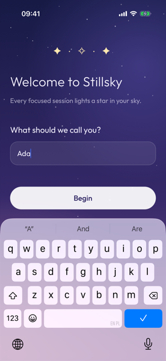
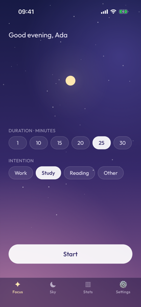
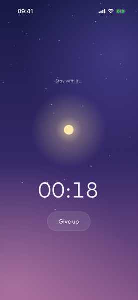
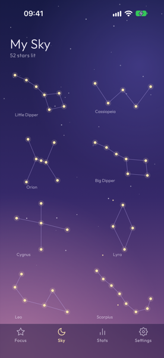
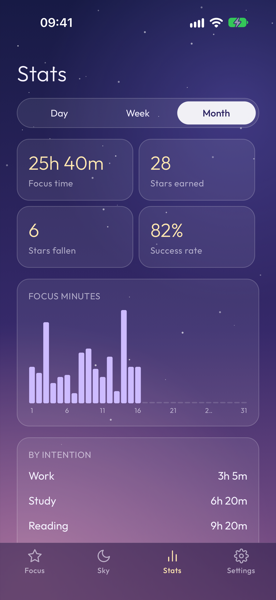
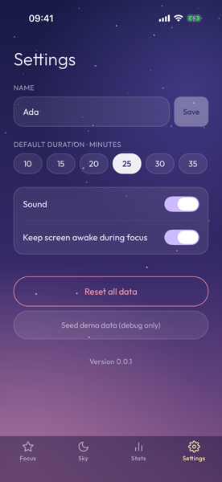
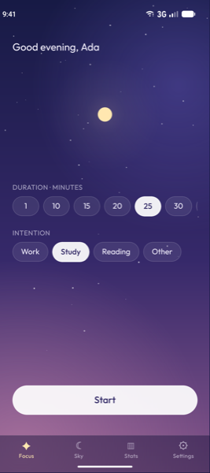
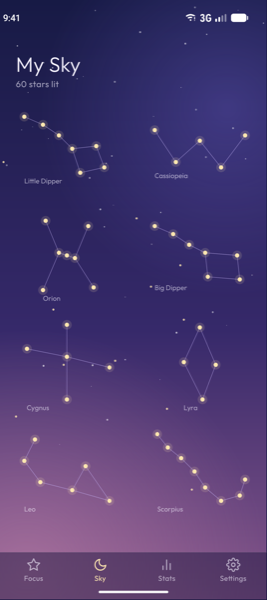

<div align="center">

# ✦ Stillsky

**A calm focus timer where every finished session lights a star.**

Fill constellations by staying focused. Give up early, and your star falls.












<sub>iPhone 18 Pro (iOS 27) and Pixel 9 (Android 17)</sub>

</div>

---

## Features

- **Focus sessions:** pick 10–120 minutes and an intention (Work, Study, Reading, Other). The star
  brightens as time passes.
- **A sky that grows:** each completed session lights the next star in 8 constellations, from the
  Little Dipper to Scorpius. Tap a constellation to see your progress.
- **Honest stats:** focus time, stars earned and fallen, success rate, minutes per hour, weekday
  or day, and a breakdown by intention.
- **Calm by design:** a dusk gradient with soft haze, frosted glass surfaces and the Outfit font.
- **Private:** no account, no backend. Everything stays on the device.
- **Survives being killed:** a session that ends while the app is closed still counts.

## Built for test automation

Stillsky is a practice target for mobile E2E testing with **Appium**, **Mobilewright** and
**Maestro**, so it is designed to be easy to automate:

- Every interactive or asserted element has a stable `testID` **and** an accessibility label,
  usually its visible text (a few are more descriptive, e.g. the Settings "Save" button is
  "Save name"). All IDs live in [`src/testIds.ts`](src/testIds.ts) and follow
  `screen.element`: `onboarding.nameInput`, `focus.duration.25`, `focus.intention.study`,
  `sky.constellation.orion`, `stats.bar.3`, `settings.resetButton`, `tabs.sky`…
- SVG drawings (constellations, chart bars) carry transparent overlay views with test IDs,
  because SVG shapes are not exposed to automation.
- Debug builds add a **1-minute duration** and a **Seed demo data** button, so tests don't wait
  25 minutes or start from an empty sky.
- The same 8 scenarios are automated three times, as [Maestro flows](e2e/maestro/), a
  [Mobilewright suite](e2e/mobilewright/) and an [Appium suite](e2e/appium/), on both platforms.

| Interesting scenarios to automate | |
|---|---|
| Onboarding validation (empty, whitespace-only, 21-character, emoji names) | forms |
| Start → Give up → Cancel / Confirm, with a confirmation dialog | dialogs |
| Complete a 1-minute session → star appears in Sky, numbers change in Stats | waits, cross-screen state |
| Kill the app mid-session, relaunch after the end → counted as completed | app lifecycle |
| Horizontal duration picker where the value you need is off-screen | swipes, scrolling |
| Toggles and default duration persist across relaunch | persistence |
| Reset requires typing `RESET` exactly | disabled states |

## Getting started

**Prerequisites:** Node 22.12+, Xcode 27 + CocoaPods for iOS (E2E suites use an iPhone 18 Pro
simulator on iOS 27), Android Studio with an emulator and JDK 17+ for Android. In `~/.zshrc`:

```bash
export ANDROID_HOME=$HOME/Library/Android/sdk
export PATH=$PATH:$ANDROID_HOME/emulator:$ANDROID_HOME/platform-tools
```

```bash
npm install
cd ios && bundle install && bundle exec pod install && cd ..
npm start            # Metro bundler, keep it running
npm run ios          # iOS simulator
npm run android      # Android emulator
```

## Tests

```bash
npm test                           # unit tests (Vitest): domain rules, storage, app state (AppProvider)
npm run e2e:maestro:ios            # all Maestro flows (~8–9 min, includes real 1-minute sessions)
npm run e2e:maestro:smoke:ios      # fast subset (~2–3 min)
npm run e2e:mobilewright:ios       # Mobilewright suite (run `npm install` in e2e/mobilewright first)
npm run e2e:appium:ios             # Appium suite (run `npm install` in e2e/appium first)
```

Every E2E script names its platform (`:ios` or `:android`), so it never picks the wrong device
when a simulator and an emulator are both open. Swap `:ios` for `:android` for the emulator.

Suite timings per tool and platform are tracked in [e2e/BENCHMARKS.md](e2e/BENCHMARKS.md), and a
plain-language comparison of Maestro, Mobilewright and Appium is in [e2e/COMPARISON.md](e2e/COMPARISON.md).

The suites run against a **test build**: a release build with the JavaScript bundled in, so it
needs no Metro and starts in a second or two, which keeps the runs fast and stable. It keeps the
test helpers (1-minute focus, Seed demo data); the normal release build has none of them. A debug
build with Metro works too, but it is slower, and on Android its developer tools keep the
emulator busy, so tests time out at random.

**iOS runs:**

```bash
npm run ios:e2e                   # build and install the test build on the iPhone 18 Pro simulator
npm run e2e:maestro:ios
```

- **Appium and Mobilewright on iOS still need the debug build** (`npm start`, `npm run ios`).
  On the test build both hang while a focus session is running: reading the screen (XCUITest's
  accessibility snapshot, which both use) stops responding or takes minutes, so 5 of 8 specs
  fail. Maestro, which reads the screen its own way, passes on it. Not solved yet; Appium's
  `waitForIdleTimeout: 0` stops the hang but the spec still fails.

- The test build is the `E2E` configuration in Xcode (a copy of Release; CocoaPods builds it like
  Release). Its `E2E` Swift flag makes `AppDelegate.swift` pass `e2e: true` to `App`, which turns
  the test helpers on.
- Build it again after every app change (JavaScript too: it is bundled in).

**Android runs:**

```bash
npm run emulator                  # Pixel 9 emulator on the Mac's GPU
npm run android:e2e               # build and install the test build (after every app change)
npm run e2e:maestro:android       # or e2e:mobilewright:android, e2e:appium:android
```

- The test build is the `e2e` build type in `android/app/build.gradle` (a copy of release). Its
  `BuildConfig.E2E` flag makes `MainActivity.kt` pass `e2e: true` to `App`.

- `npm run emulator` starts the emulator with `-gpu host`. With the default `-gpu auto` it can
  fall back to software rendering (SwiftShader), and the app's animated sky then keeps the
  emulator so busy that the suites time out.
- The `:android` scripts first run `e2e/prepare-android.sh`. It checks that the app is installed,
  stops Mobilewright's leftover `mobilecli` helper, which otherwise blocks Maestro and Appium, and
  waits (up to 5 min) until a freshly booted emulator stops working in the background. With a
  debug build installed it also checks Metro and sets up `adb reverse`, so the app loads
  JavaScript through localhost (about 5 s per start instead of 16–22 s through the emulator's
  default `10.0.2.2`; see `DevServerHost.kt`).
- The emulator gets slower the longer it runs. Before a long test session, restart it.

## Build artifacts for Appium

Debug builds load JavaScript from Metro and include the test helpers. Release builds bundle the
JavaScript and run on their own. The test build (E2E / e2e) is a release build with the test
helpers.

**iOS simulator `.app`**

```bash
xcodebuild -workspace ios/Stillsky.xcworkspace -scheme Stillsky -configuration Release \
  -sdk iphonesimulator -destination 'generic/platform=iOS Simulator' -derivedDataPath ios/build build
# → ios/build/Build/Products/Release-iphonesimulator/Stillsky.app
# (use -configuration E2E for the test build: → E2E-iphonesimulator/Stillsky.app)
```

**Android `.apk`**

```bash
cd android
./gradlew assembleRelease   # → app/build/outputs/apk/release/app-release.apk (standalone)
./gradlew assembleE2e       # → app/build/outputs/apk/e2e/app-e2e.apk (test build, standalone)
./gradlew assembleDebug     # → app/build/outputs/apk/debug/app-debug.apk (needs Metro)
```

The release APK is signed with the template's debug keystore, which is fine for testing.

**Capabilities**

```jsonc
// iOS
{
  "platformName": "iOS",
  "appium:automationName": "XCUITest",
  "appium:deviceName": "iPhone 18 Pro",
  "appium:app": "/absolute/path/to/Stillsky.app",
  "appium:bundleId": "com.stillsky"
}

// Android
{
  "platformName": "Android",
  "appium:automationName": "UiAutomator2",
  "appium:avd": "Pixel_9",
  "appium:app": "/absolute/path/to/app-release.apk",
  "appium:appPackage": "com.stillsky",
  "appium:appActivity": ".MainActivity",
  "appium:autoGrantPermissions": true
}
```

- iOS: a testID is the accessibility identifier → `accessibility id` or `id` locators.
- Android: a testID is the view's `resource-id` → `id` locators (UiAutomator2).
- Android debug builds on Android 17 ask for local-network access (React Native uses it to reach
  Metro). `autoGrantPermissions` (Appium) or `permissions: { all: allow }` (Maestro) handles it.
  Release builds don't ask.

## Project structure

```
src/
  domain/       pure TypeScript rules: timer, constellations, stats, validation (unit-tested)
  storage/      versioned AsyncStorage with validation and migrations
  state/        AppProvider: app state and actions
  screens/      Onboarding, Focus, Sky, Stats, Settings
  components/   Star, SkyCanvas, BarChart, pickers, dialogs, gradient background
  testIds.ts    every test ID in one place
e2e/maestro/    end-to-end flows (Maestro)
e2e/mobilewright/  the same scenarios in Mobilewright
e2e/appium/     the same scenarios in Appium + WebdriverIO
docs/           design spec, implementation plan, screenshots
```

Built with React Native CLI, TypeScript, React Navigation, react-native-svg, Reanimated and
AsyncStorage. Font: [Outfit](https://github.com/Outfitio/Outfit-Fonts) (SIL Open Font License).
Tab icons: shapes from [Feather](https://feathericons.com) (MIT).
